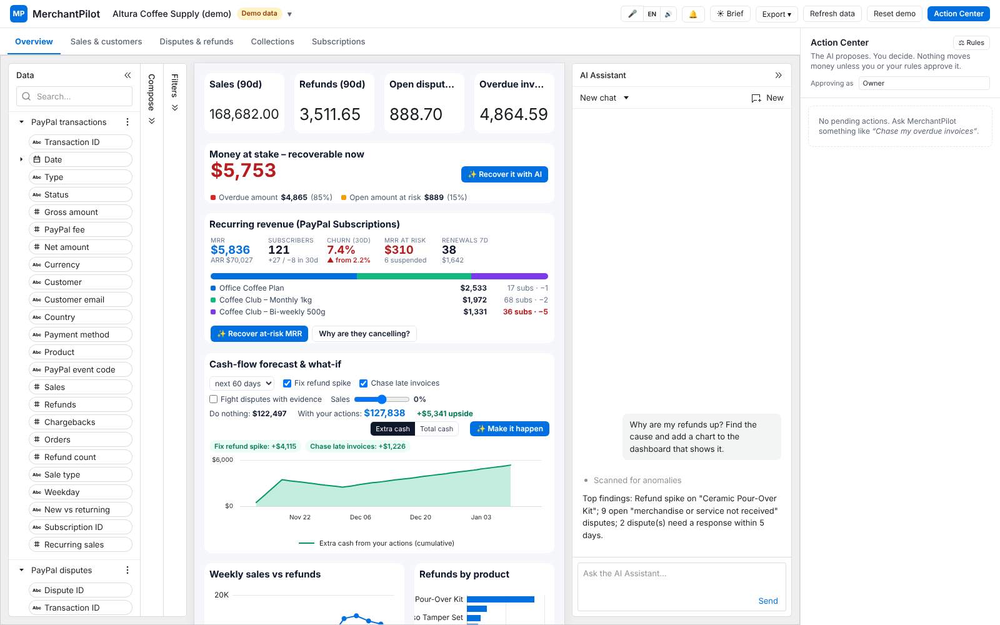
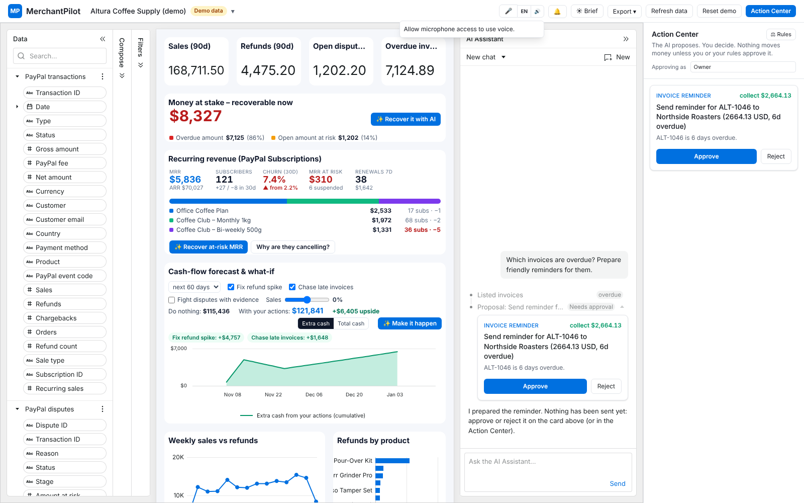
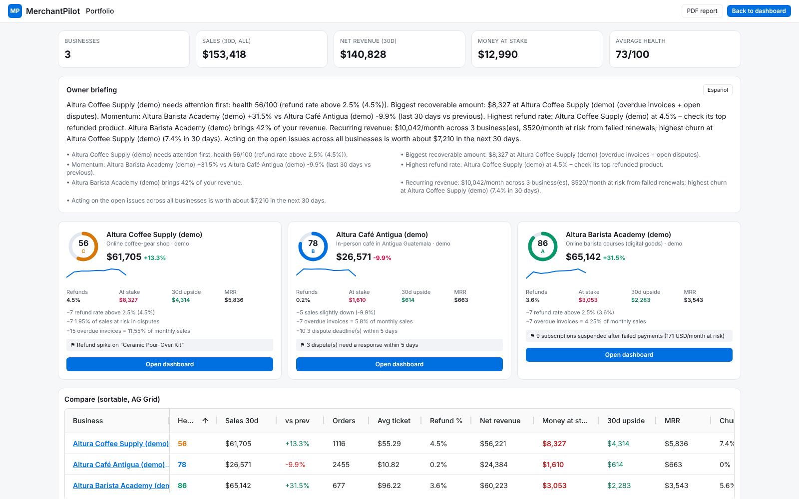
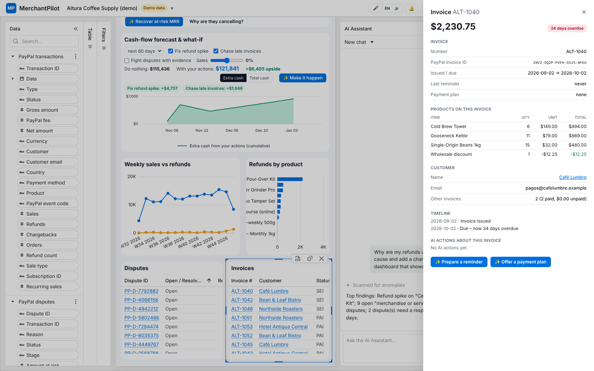
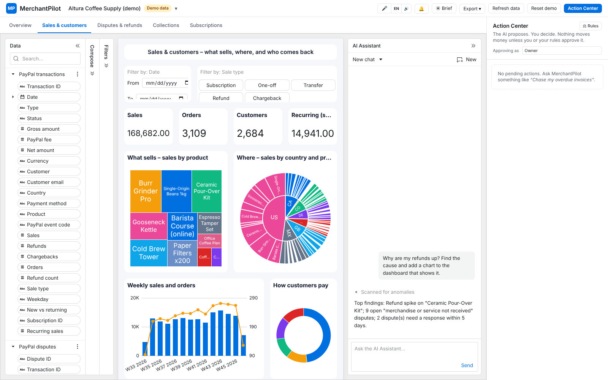
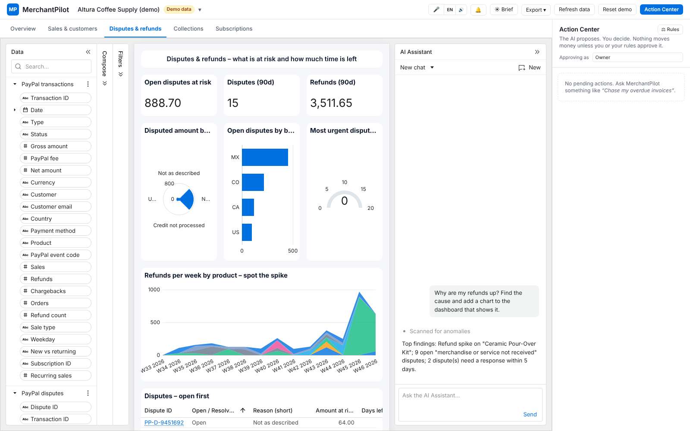
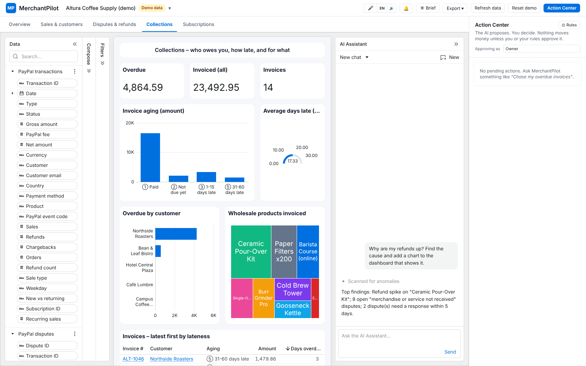
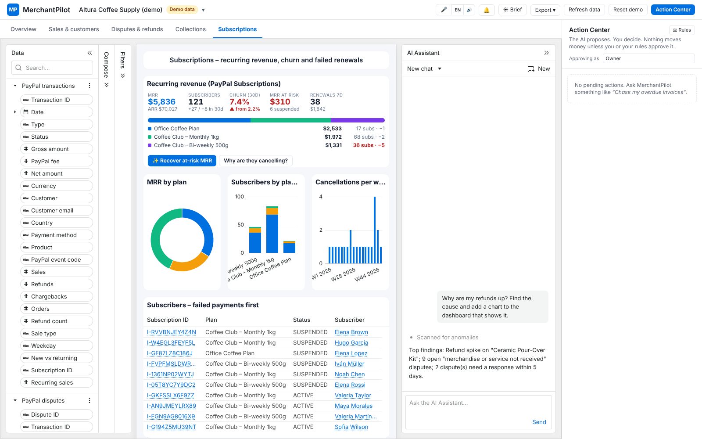

# MerchantPilot

**An AI finance copilot for small PayPal merchants.** It explains what changed in your money, shows the proof on a live AG Studio dashboard, and prepares the fixes (refunds, invoice reminders, payment plans, dispute responses). Each fix waits for your approval, then runs through the PayPal Agent Toolkit. It also tracks recurring revenue (PayPal Subscriptions), compares several businesses, forecasts cash and works from Claude/Cursor (MCP), Power BI, Excel and voice.

Built for the [PayPal AI Hackathon 2026](https://paypalaihackathon.devpost.com).

> **Live demo:** https://merchantpilot.onrender.com (no login, no setup, free to test) · **Video:** [YouTube](https://youtu.be/Ntu2zmh_99g) · **Devpost:** [submission](https://devpost.com/software/merchanpilot) · **Judge quick start:** [below](#how-to-test) and on the home page



| Approve in the chat | Portfolio of businesses | Click anything for details |
|---|---|---|
|  |  |  |

| Sales & customers | Disputes & refunds | Collections | Subscriptions |
|---|---|---|---|
|  |  |  |  |

---

## How to test

**No account, login or API key is needed.** Open https://merchantpilot.onrender.com and click **Open the dashboard**. The hosted app already holds its PayPal sandbox and AI model keys on the server (they never reach the browser). It stays online (always-on Render instance) and free to use through the end of judging (December 15, 2026).

The business menu (top left) has two kinds of data:

| Business | Data | What to try |
|---|---|---|
| **Altura Coffee Supply (demo)** – opens by default | Deterministic 90-day demo story: refund spike, carrier disputes, late wholesale invoices, Coffee Club churn and failed renewals | Every starter question in the AI panel; approve proposals; **Reset demo** restores the data at any time |
| **Altura Coffee Supply (sandbox)** – label *Live* | The real **PayPal sandbox** account: Transaction Search, Disputes, Invoicing and Subscriptions APIs | Approved actions execute on the PayPal sandbox (refunds, invoice reminders, payment plans, dispute responses); signed webhooks raise 🔔 alerts |
| **Altura Coffee Shop (demo)**, **Altura Barista Academy (demo)** | Two more demo businesses | **Portfolio overview** compares all of them |

Everything is sandbox or clearly labelled demo data. **No real money moves.**

**Easiest: the guided tour.** On the first visit the dashboard offers a 3-minute tour (also the **▶ Guided tour** button in the header, or https://merchantpilot.onrender.com/dashboard?tour=1). Each step has a one-click button that does the action for you (asks the AI, switches page, opens a drawer or the rules) and ticks itself off when you complete it, for example when you approve an action.

**Or follow the same path yourself:**

1. In the **AI Assistant** panel (right), click **"Why are refunds up?"**. The agent queries the data, explains the cause and asks AG Studio to add the chart that proves it.
2. Click **"Chase overdue invoices"**. A card appears in the chat; press **Approve** and see it executed and logged in the **Action Center** audit trail.
3. Use the page tabs (*Overview, Sales & customers, Disputes & refunds, Collections, Subscriptions*). Click any invoice number, customer or dispute in a grid to open its detail drawer.
4. Business menu → **Portfolio overview**: health score and owner briefing for every business.
5. **Export** → executive PDF, Excel or the Power BI feed.

**Running it yourself:** see [Run locally](#run-locally). Without any keys it runs fully on demo data (`LLM_PROVIDER=mock` even runs the agent loop without an AI key). To use live data, create a free PayPal sandbox app at [developer.paypal.com](https://developer.paypal.com) → *Apps & Credentials* and put its Client ID/Secret in `.env.local`; `npm run seed:sandbox` fills it with payments, refunds and invoices. For checkout and subscription tests, use a sandbox *Personal* (buyer) account from the same dashboard (*Testing Tools → Sandbox accounts*); sandbox only, no real money.

## The problem

Small merchants live inside PayPal but can't see *why* their money moves. Refunds creep up, disputes hit their deadlines unnoticed, and wholesale invoices go unpaid for weeks. The data exists in PayPal, but turning it into a decision takes an analyst they don't have.

## What it does

1. **Ask** – "Why are my refunds up?" MerchantPilot reads transactions, disputes and invoices and runs deterministic anomaly detection. It finds, for example, that about 40% of *Ceramic Pour-Over Kit* orders were refunded in the last 10 days, versus under 2% before (a damaged batch).
2. **See** – it delegates to **AG Studio's built-in agents**, which add the chart that proves the finding to the dashboard.
3. **Approve** – it *proposes* actions such as refunding the affected buyers, reminding the café whose invoice is 34 days late, or accepting a lost-package dispute. Each proposal appears as a card with **Approve / Reject right inside the chat** (and in the **Action Center**). Nothing moves money until the merchant clicks *Approve*. Approved actions then execute through the **PayPal Agent Toolkit**.
4. **Govern** – the merchant sets **approval rules** (⚖ Rules): auto-approve refunds up to a small amount or invoice reminders, require **two different approvers** above a threshold, and cap daily money out. The AI works inside the rules; every decision (who, when, which rule) lands in a persistent **audit trail** (Postgres).
5. **Look ahead** – a **cash-flow forecast & what-if** widget (AG Charts inside a custom AG Studio widget) projects the next 30-90 days and shows the extra cash from fixing the refund spike, chasing invoices or fighting disputes; the agent answers *"what is fixing this worth?"* with the same model.
6. **Fight & collect** – one click builds a **dispute evidence pack (PDF)** and, after approval, submits it through PayPal's Disputes API; overdue invoices can be offered as a **payment plan** (PayPal partial payments + reminder with the pay link).
7. **Morning brief** – a daily summary (email via Resend, or WhatsApp) with **signed one-tap approve links** that go through the same rules and audit trail.
8. **Everywhere** – MerchantPilot is also an **MCP server** (`/api/mcp`): ask about your PayPal business and queue actions from Claude Desktop, Cursor or any MCP client; proposals come back with signed approve links. **Voice** in Spanish/English, **real-time alerts** from PayPal webhooks (new dispute → toast → "Ask AI"), and **QuickBooks / Xero** exports for the accountant.
9. **Many businesses, one owner** – switch between stores or completely different businesses (each with its own PayPal app; secrets stored AES-256-GCM encrypted). The **Portfolio** page scores every business 0-100 (grade A-D, with the reason behind every point lost), consolidates sales / net / money at stake, writes an owner briefing (EN/ES), compares them in an AG Grid + AG Charts view and exports a consolidated PDF. The agent and MCP get a `portfolio_overview` tool (*"which business needs me first?"*).
10. **Recurring revenue** – PayPal Subscriptions support: MRR/ARR, active subscribers, churn vs previous period, subscriptions suspended after failed renewals (MRR at risk), renewals due, per-plan breakdown; alerts from `BILLING.SUBSCRIPTION.*` webhooks; a `paypal_subscriptions` tool for the agent and MCP. Invoices carry product line items.
11. **Drill down** – click any invoice number, customer, dispute or transaction in the dashboard grids to open a detail drawer: invoice timeline, customer segment / lifetime value / refunds, dispute context and evidence pack, related transactions, with one-click AI actions.
12. **Share** – one click (or one sentence in the chat: *"send me this month's report"*) produces an **executive PDF** with an AI-written summary, an **Excel workbook** with every table ready for pivots, CSVs, or a **live OData feed for Power BI and Excel** that refreshes from PayPal.

## Impact

What MerchantPilot surfaces in the first minute on the demo business (Altura Coffee Supply, a one-owner coffee brand with no analyst):

| Finding | Money involved | What the owner can do, after one click |
|---|---|---|
| Refund spike on one product (damaged batch): ~40% refunded vs <2% before | ~1,450 USD refunded in 10 days | See the proof chart, refund the affected buyers, stop selling the batch |
| 3 overdue wholesale invoices (up to 34 days late) | ~4,860 USD | Send reminders or offer a PayPal payment plan |
| 12 open disputes, 2 due within 5 days, most "not received" in two countries | ~890 USD at risk | Prioritize by deadline, submit an evidence pack |
| 6 subscriptions suspended after failed renewals; churn up from 2% to 7% | ~310 USD/month MRR at risk | Ask subscribers to update their payment method |

That is **about 5,750 USD of money at stake plus ~310 USD/month of recurring revenue**, found, explained and turned into ready-to-approve actions. Without the tool it means hours of exports and spreadsheets. (Demo figures are generated relative to today, so they move slightly from day to day.)

Who it is for: the millions of small merchants who sell through PayPal (online shops, cafés, course creators, wholesalers) and make money decisions alone. The human-approval design makes it safe to let an AI act on real money: the AI prepares, the owner decides, the rules and audit trail keep it accountable.

## AI tools used

| Where | Tool | Role |
|---|---|---|
| In the product | **Anthropic Claude** (`claude-haiku-4-5` on the hosted demo; OpenAI models also supported) through the **Vercel AI SDK** | Powers the MerchantPilot agent: tool calling, explanations, executive summaries, owner briefings. The model in use is shown on the home page. |
| In the product | **AG Studio Agent Framework** | The MerchantPilot agent delegates chart building to Studio's built-in agents (`delegate_to`). |
| In the product | **PayPal Agent Toolkit** (`@paypal/agent-toolkit`) | Executes approved money-moving actions on PayPal. |
| In the product | **MCP** (Model Context Protocol) | MerchantPilot is an MCP server, usable from Claude, Cursor or any MCP client. |
| Development | **Claude (Anthropic)** as a coding assistant, plus the **PayPal AI-Toolkit** plugin and MCP server for sandbox work | Helped write and test code and docs; every change was reviewed, tested (unit + browser tests) and deployed by the author. |

The AI never does arithmetic on raw data: numbers come from deterministic code (`lib/analytics.ts`), and the AI can only *propose* actions that a person approves.

## Architecture

```
Browser                                              Server (Next.js on Render)
┌─────────────────────────────────────────────┐      ┌──────────────────────────────────────────┐
│ AG Studio (dashboard + AI chat panel)        │      │ /api/llm   → AI SDK → OpenAI / Claude    │
│  ├─ MerchantPilot agent (custom, primary)    ├─────►│   (key stays on server, rate limited)    │
│  │    tools: paypal_* / propose_* / reports  │      │ /api/agent/tools/:name                   │
│  │    delegate_to → lead                     │      │   deterministic analytics, forecast,     │
│  ├─ Studio built-in agents: lead, data, …    │      │   subscriptions, portfolio (lib/*.ts)    │
│  ├─ Custom widgets: Money at stake,          │      │   propose_* → Action queue + rules       │
│  │   Recurring revenue, Cash-flow forecast   │      │ /api/actions/:id approve (or signed link)│
│  └─ Grid drill-down → detail drawer          │      │   → PayPal Agent Toolkit / REST          │
│ Action Center · Portfolio · Alerts · Voice   ├─────►│ /api/odata (Power BI) · /api/export/*    │
└─────────────────────────────────────────────┘      │ /api/mcp (Claude, Cursor, …)             │
PayPal webhooks (signature verified) ──────────────► │ /api/webhooks/paypal → alerts            │
                                                      │ Postgres: audit trail, rules, businesses │
                                                      └──────────────────────────────────────────┘
```

* **Studio Agent Framework:** a custom agent (`directLlmRunner`) talks to Studio's built-in agents through `delegate_to`. A custom `AgLlmAdapter` proxies every model turn to the server, so no API key reaches the browser. See `components/studio/`.
* **PayPal:**
  * Transaction Search, Disputes, Invoicing (with line items) and Subscriptions APIs feed the dashboard (`lib/paypal/live-data.ts`).
  * Refunds, accepted disputes and invoice reminders run through `@paypal/agent-toolkit`, with least-privilege tool configuration (`lib/paypal/toolkit.ts`). The Toolkit has no operations for dispute evidence uploads or invoice partial-payment plans, so those two use the PayPal REST API directly, behind the same approval and rules.
  * Webhooks are signature-verified.
* **Safety by design:**
  * The LLM never does arithmetic on raw rows. Tools return computed facts (`lib/analytics.ts`).
  * Proposals are validated against real data before they are queued: refundable balance, invoice status, dispute state.
  * Execution happens only on a human click (`lib/actions.ts`).
  * The server applies per-IP and daily rate limits to protect the AI budget.
* **Two data modes:**
  * **live:** your PayPal sandbox account.
  * **demo:** deterministic 90-day datasets for three fictional businesses (coffee-gear shop, café, online academy) with built-in storylines: a refund spike, a carrier dispute cluster, overdue invoices, a subscription churn spike and failed renewals. Judges always see a working product, and *Reset demo* restores it.
  * With PayPal keys set, the app opens the demo story first and lists the live sandbox account as its own business (`DEFAULT_BUSINESS=primary` opens the live one first).

## Tech stack

Next.js 16 · React 19 · TypeScript · AG Studio 3 (Agent Framework, AG Charts, AG Grid) · PayPal Agent Toolkit + REST APIs (sandbox) · Vercel AI SDK 7 (OpenAI or Anthropic) · Render · Vitest · Playwright.

## Run locally

```bash
git clone <this repo> && cd merchantpilot
npm install
cp .env.example .env.local      # optional: add PayPal sandbox + OpenAI/Anthropic keys
npm run dev                     # http://localhost:3000
```

With no keys, the app runs on demo data and the chat explains how to add a model. To try the full agent loop without any key, run `LLM_PROVIDER=mock npm run dev`.

| Command | What it does |
|---|---|
| `npm run check:env` | Live-checks PayPal OAuth, each PayPal API, the LLM and the AG Studio license |
| `npm run sandbox:subscription` | Creates the Coffee Club product + 4 plans and a subscription a sandbox buyer approves (`-- --plan monthly`, `biweekly`, `office` or `trial`; `--cancel`, `--suspend`) |
| `npm run sandbox:buyer-order` | One PayPal checkout a sandbox buyer pays or cancels (`-- --item grinder`, `--amount 0.01`, `--decline`) |
| `npm run seed:sandbox` | Creates payments, refunds and overdue invoices in your PayPal sandbox (`-- --payments 100 --refunds 21 --invoices 30`; invoices only: `-- --payments 0 --invoices 30`) |
| `npm test` | Unit tests (67): analytics, actions, LLM stream, toolkit, exports, forecast, alerts, MCP, multi-business isolation, portfolio, drill-down, Power BI feed, subscriptions |
| `npm run e2e` | Browser test of the full agent → tool → Action Center → approve loop (also `e2e:exports`, `e2e:policies`, `e2e:tanda2`, `e2e:tanda3`, `e2e:tanda4`, `e2e:tour`) |
| `npm run smoke -- <url>` | Post-deploy check of a hosted instance |

## AG Studio extensions

- **Custom widget "Money at stake"** (`components/studio/MoneyAtStakeWidget.tsx`): maps any money measures through Studio's data engine (filters apply), shows the recoverable total with a stacked breakdown and a **"Recover it with AI"** button that hands the job to MerchantPilot. Registered in Studio's widget menu under *MerchantPilot* and described to Studio's own AI agents (`ai` metadata), so they can place it too.
- **Custom widget "Recurring revenue"** (`components/studio/RecurringRevenueWidget.tsx`): MRR/ARR, subscribers, churn vs previous period, MRR at risk from failed renewals, renewals due and each plan's share, with *Recover at-risk MRR* / *Why are they cancelling?* buttons.
- **Custom widget "Cash-flow forecast & what-if"** (`components/studio/CashflowForecastWidget.tsx`): AG Charts projection with an 80% band and scenario toggles.
- **A five-page report** (`components/studio/initial-report.ts`) with a page tab bar: *Overview*, *Sales & customers* (date and button filters, treemap, sunburst, column+line combo, donut, stacked weekday chart, pivot grid), *Disputes & refunds* (nightingale, bar, radial gauge, stacked area, grid), *Collections* (aging columns, radial gauge, bar, treemap of invoiced products, grid) and *Subscriptions* (custom widget, donut, stacked columns, grid). The AI agent knows every page and points the merchant to it instead of duplicating charts.
- **Drill-down cells**: grid columns tagged with `context.drill` render as links that open a detail drawer (invoice products and timeline, customer value, dispute evidence, subscription history).
- **In-chat cards** via `aiToolDisplay`: Approve/Reject proposals and download reports inside Studio's AI panel.
- **Brand theme** via `studioTheme.withParams(...)`: PayPal blues, Inter, chart palette, softer widgets.
- **Custom agent + Studio's built-in agents** via the Agent Framework (`createAiHarness`, `delegateTo`).

## Approval rules & persistence

| Rule | Default | Notes |
|---|---|---|
| Auto-approve refunds up to | off | Capped at 100 so a public demo can't be abused. |
| Auto-send invoice reminders | off | Still max one reminder per invoice every 3 days. |
| Two-person approval above | 500 | Refunds and accepted disputes; approvers must be different people. |
| Daily money-out limit | 2,000 | Approvals beyond it are blocked until the next day. |

Rules are checked when the AI proposes **and** again at approval time. With `DATABASE_URL` set (Render Postgres in `render.yaml`) actions, rules and reminder history survive redeploys; without it they live in memory. Demo and live data are stored separately, and *Reset demo* never wipes the live audit trail. The approver name is a demo identity (no login yet).

## MCP server

`POST /api/mcp` – Streamable HTTP, stateless JSON-RPC (protocol 2025-06-18 / 2025-03-26 / 2024-11-05). 18 tools: KPIs, portfolio, subscriptions (MRR, churn), anomalies, transactions, disputes, invoices, forecast, all `propose_*` actions, report links, pending approvals. Auth: `Authorization: Bearer $MCP_API_KEY` (required with live data; open in demo mode). Send `X-Business: <id>` to target another business. Claude Desktop:

```json
{ "mcpServers": { "merchantpilot": { "command": "npx", "args": ["-y", "mcp-remote", "https://<app>/api/mcp", "--header", "Authorization:${AUTH_HEADER}"], "env": { "AUTH_HEADER": "Bearer <MCP_API_KEY>" } } } }
```

## Exports & BI

| Output | Endpoint | Notes |
|---|---|---|
| Executive PDF | `/api/export/pdf?days=30&lang=en` | KPIs, charts, priorities, audit trail. Summary written by the LLM from the same numbers (deterministic fallback). |
| Excel workbook | `/api/export/xlsx?days=30[&mode=full]` | Default: 4 sheets (Summary with KPIs, priorities and top products; Transactions; Disputes; Invoices). `mode=full`: 10 sheets as native Excel tables for pivots. |
| Portfolio PDF | `/api/export/portfolio-pdf?lang=es` | Consolidated report: totals, owner briefing, comparison table, one page per business. |
| CSV | `/api/export/csv/{Transactions,Disputes,Invoices,Products,Countries,WeeklyTrend,Findings,Actions}` | UTF-8 with BOM (opens correctly in Excel). |
| OData v4 feed | `/api/odata` (`$metadata`, `$select`, `$top`, `$skip`, `$count`) | Power BI → *Get data → OData feed*; Excel → *Data → From OData Feed*. Refreshable. Every table has `BusinessId` / `BusinessName`. |
| Portfolio feed | `/api/odata/all` | Every business stacked (composite keys `BusinessId` + key) plus a **Businesses** table with health score and grade – slice one Power BI report by business. |
| Forecast table | `/api/odata/Forecast` | 90-day do-nothing vs with-actions projection with 80% band. |
| QuickBooks / Xero | `/api/export/accounting?format=quickbooks\|xero\|summary` | Bank-statement CSVs (fees as separate lines) and a monthly journal summary. |
| Power BI file | `/api/export/pbids[?scope=all]` | Double-click to open Power BI Desktop already connected. |

Set `EXPORT_API_KEY` to protect the feed: Power BI / Excel then use **Basic** auth (any user, the key as password); scripts can pass `?key=` or a Bearer token. Downloads started from the app itself keep working.

## Deploy (Render)

`render.yaml` is a Render Blueprint. Click **New → Blueprint**, select this repo, fill in the secret env vars, and deploy. The health check is at `/api/health`. Set `NEXT_PUBLIC_AG_STUDIO_LICENSE_KEY` **before** building, because it is baked into the client bundle.

## Testing the judge flow

1. Open `/dashboard` (it opens *Altura Coffee Supply (demo)*) and use the **AI Assistant** panel.
2. Click **"Why are refunds up?"**, then **"Chase overdue invoices"**.
3. Approve a proposal **on its card in the chat** (or in the Action Center) and watch the dashboard update.
4. Ask *"Make me a PDF report of this month"* or use **Export** → PDF / Excel / Power BI.
5. Click an invoice number or customer in a grid to open the detail drawer.
6. Open the business name menu → **Portfolio overview** to compare every business.
7. On a demo business, click **Reset demo** to start over. Switch to the *Live* business to see the real PayPal sandbox data.

Optional material in Spanish (the author's language; not needed to test):

Demo story with the 8 simulated cases (Spanish): [`docs/CASO-DEMO.es.md`](docs/CASO-DEMO.es.md).
Step-by-step test guide (Spanish): [`docs/GUIA-PRUEBAS.es.md`](docs/GUIA-PRUEBAS.es.md) – PayPal webhook, sandbox disputes, MCP Inspector / Claude Desktop, Power BI, multi-business.
PayPal AI-Toolkit + MerchantPilot MCP side by side in Claude Code (Spanish): [`docs/GUIA-AI-TOOLKIT.es.md`](docs/GUIA-AI-TOOLKIT.es.md).

## License

MIT (see `LICENSE`). AG Studio is commercial software from AG Grid Ltd, used here under its trial license.
