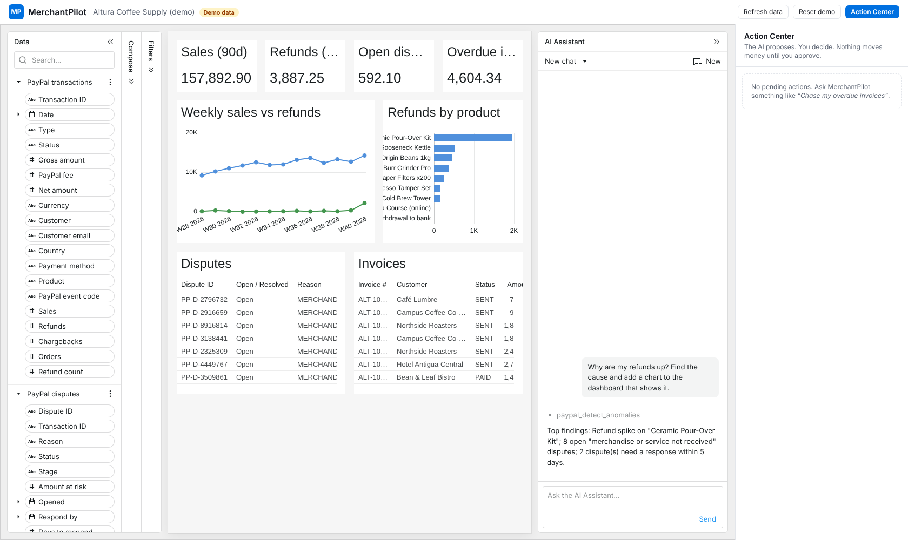

# MerchantPilot

**An AI finance copilot for small PayPal merchants.** It explains what changed in your money, shows the proof on a live AG Studio dashboard, and prepares the fixes (refunds, invoice reminders, dispute actions). Each fix waits for your approval, then runs through the PayPal Agent Toolkit.

Built for the [PayPal AI Hackathon 2026](https://paypalaihackathon.devpost.com).

> **Live demo:** `https://<your-app>.onrender.com` · **Video:** `<YouTube link>`



---

## The problem

Small merchants live inside PayPal but can't see *why* their money moves. Refunds creep up, disputes hit their deadlines unnoticed, and wholesale invoices go unpaid for weeks. The data exists in PayPal, but turning it into a decision takes an analyst they don't have.

## What it does

1. **Ask** – "Why are my refunds up?" MerchantPilot reads transactions, disputes and invoices and runs deterministic anomaly detection. It finds, for example, that 54% of *Ceramic Pour-Over Kit* orders were refunded in the last 10 days, versus 2% before.
2. **See** – it delegates to **AG Studio's built-in agents**, which add the chart that proves the finding to the dashboard.
3. **Approve** – it *proposes* actions such as refunding the affected buyers, reminding the café whose invoice is 34 days late, or accepting a lost-package dispute. Each proposal appears as a card with **Approve / Reject right inside the chat** (and in the **Action Center**). Nothing moves money until the merchant clicks *Approve*. Approved actions then execute through the **PayPal Agent Toolkit**.
4. **Govern** – the merchant sets **approval rules** (⚖ Rules): auto-approve refunds up to a small amount or invoice reminders, require **two different approvers** above a threshold, and cap daily money out. The AI works inside the rules; every decision (who, when, which rule) lands in a persistent **audit trail** (Postgres).
5. **Look ahead** – a **cash-flow forecast & what-if** widget (AG Charts inside a custom AG Studio widget) projects the next 30-90 days and shows the extra cash from fixing the refund spike, chasing invoices or fighting disputes; the agent answers *"what is fixing this worth?"* with the same model.
6. **Fight & collect** – one click builds a **dispute evidence pack (PDF)** and, after approval, submits it through PayPal's Disputes API; overdue invoices can be offered as a **payment plan** (PayPal partial payments + reminder with the pay link).
7. **Morning brief** – a daily summary (email via Resend, or WhatsApp) with **signed one-tap approve links** that go through the same rules and audit trail.
8. **Share** – one click (or one sentence in the chat: *"send me this month's report"*) produces an **executive PDF** with an AI-written summary, an **Excel workbook** with every table ready for pivots, CSVs, or a **live OData feed for Power BI and Excel** that refreshes from PayPal.

## Architecture

```
Browser                                            Server (Next.js on Render)
┌───────────────────────────────────────────┐      ┌────────────────────────────────────────┐
│ AG Studio (dashboard + AI chat panel)      │      │ /api/llm      → AI SDK → OpenAI/Claude │
│  ├─ MerchantPilot agent  (custom, primary) ├─────►│   (key stays on server, NDJSON stream) │
│  │    tools: paypal_* / propose_*          │      │ /api/agent/tools/:name                 │
│  │    delegate_to → lead                   │      │   analytics + PayPal reads (REST)      │
│  └─ Studio built-in agents: lead, data,    │      │   propose_* → Action queue             │
│       page, planning, widget               │      │ /api/actions/:id  approve              │
│ Action Center (approve / reject)           ├─────►│   → PayPal Agent Toolkit               │
└───────────────────────────────────────────┘      │     (create_refund, send_invoice_      │
                                                    │      reminder, accept_dispute_claim)   │
PayPal webhooks ─────────────────────────────────► │ /api/webhooks/paypal (verified)        │
                                                    └────────────────────────────────────────┘
```

* **Studio Agent Framework:** a custom agent (`directLlmRunner`) talks to Studio's built-in agents through `delegate_to`. A custom `AgLlmAdapter` proxies every model turn to the server, so no API key reaches the browser. See `components/studio/`.
* **PayPal:**
  * Transaction Search, Disputes and Invoicing APIs feed the dashboard (`lib/paypal/live-data.ts`).
  * Money-moving operations run only through `@paypal/agent-toolkit`, with least-privilege tool configuration (`lib/paypal/toolkit.ts`).
  * Webhooks are signature-verified.
* **Safety by design:**
  * The LLM never does arithmetic on raw rows. Tools return computed facts (`lib/analytics.ts`).
  * Proposals are validated against real data before they are queued: refundable balance, invoice status, dispute state.
  * Execution happens only on a human click (`lib/actions.ts`).
  * The server applies per-IP and daily rate limits to protect the AI budget.
* **Two data modes:**
  * **live:** your PayPal sandbox account.
  * **demo:** a deterministic 90-day dataset for a fictional coffee-gear shop, with built-in storylines. Judges always see a working product, and *Reset demo* restores it.

## Tech stack

Next.js 16 · React 19 · TypeScript · AG Studio 3 (Agent Framework, AG Charts, AG Grid) · PayPal Agent Toolkit + REST APIs (sandbox) · Vercel AI SDK 7 (OpenAI or Anthropic) · Render · Vitest · Playwright.

## Run locally

```bash
git clone <this repo> && cd merchantpilot
npm install
cp .env.example .env.local      # optional: add PayPal sandbox + OpenAI/Anthropic keys
npm run dev                     # http://localhost:3000
```

With no keys, the app runs on demo data and the chat explains how to add a model. To try the full agent loop without any key, run `LLM_PROVIDER=mock npm run dev`.

| Command | What it does |
|---|---|
| `npm run check:env` | Live-checks PayPal OAuth, each PayPal API, the LLM and the AG Studio license |
| `npm run seed:sandbox` | Creates payments, refunds and overdue invoices in your PayPal sandbox (`-- --payments 100 --refunds 21 --no-invoices`) |
| `npm test` | Unit tests: analytics, actions, LLM stream conversion, toolkit wiring |
| `npm run e2e` | Browser test of the full agent → tool → Action Center → approve loop |
| `npm run smoke -- <url>` | Post-deploy check of a hosted instance |

## AG Studio extensions

- **Custom widget "Money at stake"** (`components/studio/MoneyAtStakeWidget.tsx`): maps any money measures through Studio's data engine (filters apply), shows the recoverable total with a stacked breakdown and a **"Recover it with AI"** button that hands the job to MerchantPilot. Registered in Studio's widget menu under *MerchantPilot* and described to Studio's own AI agents (`ai` metadata), so they can place it too.
- **In-chat cards** via `aiToolDisplay`: Approve/Reject proposals and download reports inside Studio's AI panel.
- **Brand theme** via `studioTheme.withParams(...)`: PayPal blues, Inter, chart palette, softer widgets.
- **Custom agent + Studio's built-in agents** via the Agent Framework (`createAiHarness`, `delegateTo`).

## Approval rules & persistence

| Rule | Default | Notes |
|---|---|---|
| Auto-approve refunds up to | off | Capped at 100 so a public demo can't be abused. |
| Auto-send invoice reminders | off | Still max one reminder per invoice every 3 days. |
| Two-person approval above | 500 | Refunds and accepted disputes; approvers must be different people. |
| Daily money-out limit | 2,000 | Approvals beyond it are blocked until the next day. |

Rules are checked when the AI proposes **and** again at approval time. With `DATABASE_URL` set (Render Postgres in `render.yaml`) actions, rules and reminder history survive redeploys; without it they live in memory. Demo and live data are stored separately, and *Reset demo* never wipes the live audit trail. The approver name is a demo identity (no login yet).

## Exports & BI

| Output | Endpoint | Notes |
|---|---|---|
| Executive PDF | `/api/export/pdf?days=30&lang=en` | KPIs, charts, priorities, audit trail. Summary written by the LLM from the same numbers (deterministic fallback). |
| Excel workbook | `/api/export/xlsx?days=30` | Summary + 9 sheets as native Excel tables, currency formats, data bars, deadline highlighting. |
| CSV | `/api/export/csv/{Transactions,Disputes,Invoices,Products,Countries,WeeklyTrend,Findings,Actions}` | UTF-8 with BOM (opens correctly in Excel). |
| OData v4 feed | `/api/odata` (`$metadata`, `$select`, `$top`, `$skip`, `$count`) | Power BI → *Get data → OData feed*; Excel → *Data → From OData Feed*. Refreshable. |
| Forecast table | `/api/odata/Forecast` | 90-day do-nothing vs with-actions projection with 80% band. |
| Power BI file | `/api/export/pbids` | Double-click to open Power BI Desktop already connected. |

Set `EXPORT_API_KEY` to protect the feed: Power BI / Excel then use **Basic** auth (any user, the key as password); scripts can pass `?key=` or a Bearer token. Downloads started from the app itself keep working.

## Deploy (Render)

`render.yaml` is a Render Blueprint. Click **New → Blueprint**, select this repo, fill in the secret env vars, and deploy. The health check is at `/api/health`. Set `NEXT_PUBLIC_AG_STUDIO_LICENSE_KEY` **before** building, because it is baked into the client bundle.

## Testing the judge flow

1. Open `/dashboard` and use the **AI Assistant** panel.
2. Click **"Why are refunds up?"**, then **"Chase overdue invoices"**.
3. Approve a proposal **on its card in the chat** (or in the Action Center) and watch the dashboard update.
4. Ask *"Make me a PDF report of this month"* or use **Export** → PDF / Excel / Power BI.
5. Click **Reset demo** to start over.

## License

MIT (see `LICENSE`). AG Studio is commercial software from AG Grid Ltd, used here under its trial license.
